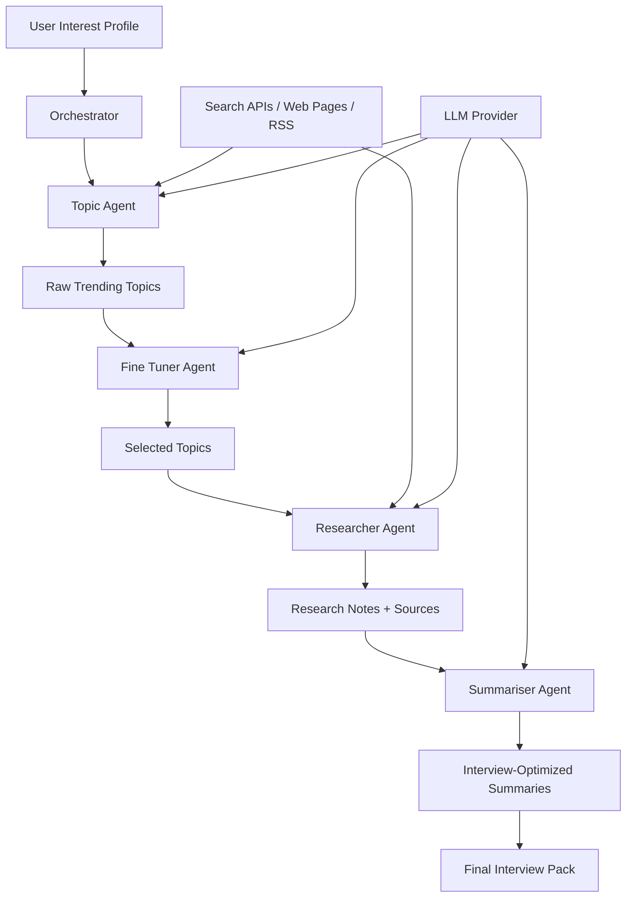
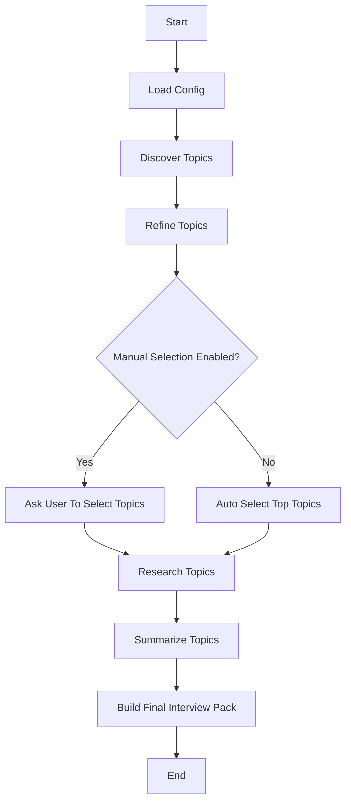

# AI Tech Topic Research Agent - Project Execution Plan

## 1. Project Overview

### Problem Statement

Build a multi-agent AI system that discovers hot technology topics from the internet, filters and refines them according to the user's interests, researches selected topics in depth, and generates interview-optimized summaries in simple language with examples.

The system should help a learner or interview candidate quickly understand emerging technology trends, why they matter, how they work, where they are used, and how to explain them clearly in interviews.

### Core Outcome

Given a user interest profile such as:

```text
I am interested in backend engineering, AI infrastructure, distributed systems,
developer tools, and topics useful for software engineering interviews.
```

The system should produce:

1. A ranked list of trending tech topics.
2. A refined shortlist matched to the user's interests.
3. In-depth research notes for each selected topic.
4. A polished interview-focused summary for each topic.
5. Optional follow-up questions, examples, analogies, and talking points.

---

## 2. Recommended Product Shape

### Phase 1 Product

A command-line Python application:

```bash
python main.py run --interests "AI agents, backend systems, cloud infra" --topics 5
```

It should output Markdown files under:

```text
outputs/
  run_2026_05_30_153000/
    trending_topics.md
    refined_topics.md
    research/
      topic_1_vector_databases.md
      topic_2_mcp.md
    summaries/
      topic_1_vector_databases.md
      topic_2_mcp.md
    final_interview_pack.md
```

### Phase 2 Product

A lightweight web UI using FastAPI plus a simple frontend. The user can:

- Enter interests.
- Start a research run.
- Review discovered topics.
- Select topics manually or let the fine-tuner select them.
- View research notes and summaries.
- Export a final interview pack.

### Phase 3 Product

Advanced features:

- Scheduled weekly topic discovery.
- User memory/profile.
- Source credibility scoring.
- Duplicate topic clustering.
- PDF/Notion/Google Docs export.
- Interview question generation.
- Flashcards.
- Podcast-style audio summary.

---

## 3. High-Level Architecture



### Main Components

1. **CLI or API Layer**
   - Accepts user interests, topic count, run mode, and model configuration.

2. **Agent Orchestrator**
   - Controls the flow between agents.
   - Handles retries, logging, state, and structured outputs.

3. **Topic Agent**
   - Searches the web for current trending tech topics.
   - Produces a structured topic list with evidence.

4. **Fine Tuner Agent**
   - Scores topics against user interests.
   - Removes duplicates and low-value topics.
   - Selects the best topics for research.

5. **Researcher Agent**
   - Searches articles, blogs, docs, papers, and news sources.
   - Scrapes and extracts useful information.
   - Produces structured research notes with citations.

6. **Summariser Agent**
   - Turns raw research into clear interview-focused explanations.
   - Includes examples, analogies, tradeoffs, use cases, and likely interview questions.

7. **Storage Layer**
   - Stores run state, sources, intermediate outputs, and final Markdown.

---

## 4. Suggested Technology Stack

### Language

Use **Python**.

Reasons:

- Strong ecosystem for scraping, agent workflows, APIs, and LLM integrations.
- Easy to run locally.
- Good fit for CLI-first development.

### Agent Orchestrator Options

Recommended: **LangGraph**

Why:

- Good for multi-step agent workflows.
- Supports graph-based state transitions.
- Easier to extend when flows become complex.
- Better than plain sequential scripts once conditional routing, retries, and review steps are needed.

Alternative options:

- **CrewAI**: Good mental model for role-based agents, but less explicit state control.
- **AutoGen**: Powerful multi-agent conversations, but heavier for this use case.
- **Plain Python services**: Best for simplicity, but may become messy as complexity grows.

Decision:

Use **LangGraph + Pydantic structured outputs**.

### Web Search and Scraping

Start with a hybrid approach:

1. **Search discovery**
   - Tavily API, SerpAPI, Brave Search API, Exa, or DuckDuckGo search library.
   - For free/low-cost early development, try DuckDuckGo search first.

2. **Article extraction**
   - `trafilatura` for clean article extraction.
   - `beautifulsoup4` for fallback parsing.
   - `httpx` for async fetching.

3. **RSS sources**
   - Hacker News.
   - GitHub Trending.
   - The Verge tech.
   - TechCrunch.
   - Google AI Blog.
   - OpenAI Blog.
   - Anthropic News.
   - AWS / Google Cloud / Azure blogs.
   - InfoQ.
   - Martin Fowler.
   - Thoughtworks Technology Radar.

### LLM Options

The user does not currently have a model running locally. There are two practical paths.

#### Option A: Online LLM API

Best for quality and speed.

Possible providers:

- OpenAI API.
- Anthropic API.
- Google Gemini API.
- Groq API.
- Together AI.
- OpenRouter.

Pros:

- Strong summarization and reasoning.
- No local hardware setup.
- Easier to build first version.

Cons:

- Requires API key.
- May have usage costs.

#### Option B: Local Model

Use Ollama with a model such as:

- `llama3.1:8b`
- `qwen2.5:7b`
- `mistral:7b`
- `phi4-mini`

Pros:

- Private and local.
- No per-call cost.

Cons:

- Lower quality than top hosted models.
- Can be slow depending on machine.
- Needs installation and model download.

Recommended approach:

Build a provider abstraction so either can be used:

```text
LLMProvider
  OpenAIProvider
  GeminiProvider
  GroqProvider
  OllamaProvider
```

Start with one hosted provider for speed, but keep Ollama support in the design.

---

## 5. Agent Responsibilities

## 5.1 Topic Agent

### Goal

Find currently trending technology topics from multiple online sources.

### Inputs

- User interests.
- Number of raw topics to discover.
- Time window, such as last 7 days, last 30 days, or current quarter.
- Optional source list.

### Tasks

1. Search the web for trending tech topics.
2. Pull candidates from RSS feeds and curated sources.
3. Normalize topic names.
4. Group duplicates.
5. Score topics by trend strength.
6. Return structured topic candidates.

### Output Schema

```python
class TopicCandidate(BaseModel):
    title: str
    short_description: str
    category: str
    trend_reason: str
    evidence_sources: list[str]
    estimated_interview_value: int
    trend_score: int
```

### Example Output

```json
{
  "title": "Model Context Protocol",
  "short_description": "An open standard for connecting AI assistants to external tools and data sources.",
  "category": "AI Infrastructure",
  "trend_reason": "Rapid adoption by AI tooling companies and developer platforms.",
  "evidence_sources": ["https://...", "https://..."],
  "estimated_interview_value": 8,
  "trend_score": 9
}
```

---

## 5.2 Fine Tuner Agent

### Goal

Select the most relevant topics according to the user's interests and interview goals.

### Inputs

- User interest profile.
- Topic candidates from Topic Agent.
- Number of final topics to select.

### Tasks

1. Score each topic against user interests.
2. Score interview usefulness.
3. Penalize shallow hype topics.
4. Prefer topics with strong learning value.
5. Remove duplicates or overlapping topics.
6. Return a ranked shortlist with reasoning.

### Scoring Criteria

Each topic receives:

- `interest_match_score`: 1-10
- `interview_value_score`: 1-10
- `depth_score`: 1-10
- `freshness_score`: 1-10
- `source_quality_score`: 1-10
- `final_score`: weighted total

Suggested weights:

```text
interest_match: 30%
interview_value: 25%
depth: 20%
freshness: 15%
source_quality: 10%
```

### Output Schema

```python
class RefinedTopic(BaseModel):
    title: str
    reason_selected: str
    relevance_to_user: str
    expected_learning_outcome: str
    scores: dict[str, int]
    source_urls: list[str]
```

---

## 5.3 Researcher Agent

### Goal

Research selected topics deeply using online articles, documentation, blogs, and credible sources.

### Inputs

- Refined topic.
- Research depth setting.
- Source preferences.

### Tasks

1. Generate search queries for the topic.
2. Search for high-quality sources.
3. Fetch and extract page content.
4. Deduplicate similar pages.
5. Rank sources by credibility.
6. Extract facts, definitions, examples, tradeoffs, and interview-relevant details.
7. Return structured research notes.

### Preferred Source Priority

1. Official documentation.
2. Engineering blogs from reputable companies.
3. Research papers or standards pages.
4. High-quality technical blogs.
5. News articles.
6. Community discussions, only as supporting signal.

### Output Schema

```python
class ResearchSource(BaseModel):
    url: str
    title: str
    publisher: str | None
    extracted_at: str
    credibility_score: int
    key_points: list[str]

class ResearchNotes(BaseModel):
    topic: str
    definition: str
    why_it_matters: list[str]
    technical_details: list[str]
    examples: list[str]
    use_cases: list[str]
    limitations: list[str]
    related_topics: list[str]
    sources: list[ResearchSource]
```

---

## 5.4 Summariser Agent

### Goal

Create a clear, detailed, interview-optimized summary.

### Inputs

- Research notes.
- User experience level.
- Interview target, such as backend, AI, system design, frontend, data engineering.

### Tasks

1. Explain the topic in simple language.
2. Add a beginner-friendly analogy.
3. Explain how it works technically.
4. Add real-world examples.
5. Explain why companies care.
6. Add pros, cons, and tradeoffs.
7. Add likely interview questions and sample answers.
8. Add a concise final revision sheet.

### Summary Template

Each topic summary should include:

```text
# Topic Name

## One-Line Explanation

## Simple Explanation

## Why This Is Trending

## How It Works

## Real-World Example

## Interview Explanation

## System Design Relevance

## Pros

## Cons / Limitations

## Common Interview Questions

## Strong Sample Answer

## Related Concepts To Learn Next

## Sources
```

---

## 6. Orchestration Design

### LangGraph State

```python
class ResearchAgentState(TypedDict):
    user_interests: str
    target_audience: str
    raw_topics: list[TopicCandidate]
    refined_topics: list[RefinedTopic]
    selected_topics: list[str]
    research_notes: dict[str, ResearchNotes]
    summaries: dict[str, str]
    errors: list[str]
    run_id: str
```

### Graph Flow



### Error Handling

Each agent should:

- Return structured errors instead of crashing when possible.
- Retry transient network failures.
- Skip failed sources and continue with available sources.
- Save partial outputs after every major step.

---

## 7. Proposed Repository Structure

```text
ResearchAgent/
  README.md
  PROJECT_EXECUTION_PLAN.md
  pyproject.toml
  .env.example
  src/
    research_agent/
      __init__.py
      main.py
      config.py
      graph.py
      state.py
      agents/
        __init__.py
        topic_agent.py
        fine_tuner_agent.py
        researcher_agent.py
        summariser_agent.py
      llm/
        __init__.py
        base.py
        openai_provider.py
        gemini_provider.py
        ollama_provider.py
      web/
        __init__.py
        search.py
        scrape.py
        rss.py
        source_ranker.py
      models/
        __init__.py
        topic.py
        research.py
        summary.py
      storage/
        __init__.py
        markdown_writer.py
        run_store.py
      prompts/
        topic_agent.md
        fine_tuner_agent.md
        researcher_agent.md
        summariser_agent.md
  tests/
    test_fine_tuner.py
    test_source_ranker.py
    test_markdown_writer.py
  outputs/
```

---

## 8. Configuration

Use `.env` for secrets:

```text
LLM_PROVIDER=openai
OPENAI_API_KEY=
GEMINI_API_KEY=
GROQ_API_KEY=
TAVILY_API_KEY=
SERPAPI_API_KEY=
OLLAMA_BASE_URL=http://localhost:11434
DEFAULT_MODEL=gpt-4.1-mini
```

Use a typed config class:

```python
class Settings(BaseSettings):
    llm_provider: str = "openai"
    default_model: str = "gpt-4.1-mini"
    max_topics_discovered: int = 20
    max_topics_selected: int = 5
    max_sources_per_topic: int = 8
    request_timeout_seconds: int = 20
```

---

## 9. Prompt Design

### Topic Agent Prompt

```text
You are a technology trend analyst.

Find current high-signal technology topics that are useful for software engineers
to understand for interviews and career growth.

User interests:
{user_interests}

Return topics that are:
- Current or increasingly relevant.
- Technically meaningful.
- Useful for interviews.
- Backed by evidence from credible sources.

Avoid:
- Pure hype with no technical depth.
- Duplicate topics.
- Vague categories like "AI" or "cloud".

Return structured JSON matching the schema.
```

### Fine Tuner Prompt

```text
You are a career-focused technical mentor.

Given a list of trending topics and a user interest profile, select the topics
that are most valuable for interview preparation.

Prioritize topics that:
- Match the user's interests.
- Have strong technical depth.
- Can be explained with examples.
- Are likely to appear in engineering conversations or interviews.

Return a ranked shortlist with scoring and reasoning.
```

### Researcher Prompt

```text
You are a careful technical researcher.

Use the provided source extracts to create detailed research notes for the topic.
Do not invent facts. If a point is uncertain, label it as uncertain.

Focus on:
- Definition.
- Why it matters.
- How it works.
- Architecture or implementation details.
- Real-world examples.
- Pros and cons.
- Interview relevance.
- Related concepts.

Always preserve source URLs for citation.
```

### Summariser Prompt

```text
You are an expert technical educator and interview coach.

Turn the research notes into a detailed but simple explanation.
Write for someone preparing for software engineering interviews.

Style:
- Clear and direct.
- Simple language.
- Use examples.
- Explain jargon.
- Include tradeoffs.
- Include likely interview questions and strong sample answers.

Do not sound like marketing copy.
Do not include unsupported claims.
```

---

## 10. Step-by-Step Execution Plan

## Milestone 0: Project Setup

Goal: Create the base Python project.

Tasks:

1. Initialize project structure.
2. Add `pyproject.toml`.
3. Add dependencies:
   - `langgraph`
   - `langchain-core`
   - `pydantic`
   - `pydantic-settings`
   - `httpx`
   - `beautifulsoup4`
   - `trafilatura`
   - `python-dotenv`
   - `typer`
   - `rich`
   - `pytest`
4. Create `.env.example`.
5. Add basic CLI entrypoint.

Success criteria:

- `python -m research_agent.main --help` works.
- Project imports cleanly.

---

## Milestone 1: Data Models and Storage

Goal: Define structured schemas and output writing.

Tasks:

1. Create Pydantic models for:
   - `TopicCandidate`
   - `RefinedTopic`
   - `ResearchSource`
   - `ResearchNotes`
   - `TopicSummary`
2. Create run ID generation.
3. Create output directory writer.
4. Write Markdown export helpers.

Success criteria:

- Mock data can be written into the expected `outputs/run_xxx` structure.
- Tests validate Markdown files are generated.

---

## Milestone 2: LLM Provider Abstraction

Goal: Make the system model-provider independent.

Tasks:

1. Create `LLMProvider` base interface.
2. Implement one online provider first.
3. Add Ollama provider stub or implementation.
4. Add config-driven provider selection.
5. Add structured JSON response helper.

Success criteria:

- A small prompt can be sent to configured provider.
- Provider can return text and structured JSON.
- Missing API keys produce useful errors.

---

## Milestone 3: Web Search and Scraping

Goal: Collect source material from the internet.

Tasks:

1. Implement search interface:
   - `search(query: str, max_results: int) -> list[SearchResult]`
2. Start with DuckDuckGo or another available search provider.
3. Implement article fetcher with `httpx`.
4. Implement extraction with `trafilatura`.
5. Add fallback extraction with BeautifulSoup.
6. Add source deduplication by URL and title.
7. Add basic credibility ranking.

Success criteria:

- Given a query, the app returns URLs, titles, snippets, and extracted text.
- Failed pages do not crash the full run.

---

## Milestone 4: Topic Agent

Goal: Generate a list of trending topics.

Tasks:

1. Create source queries such as:
   - `trending software engineering topics this month`
   - `latest AI infrastructure trends`
   - `developer tools trending`
   - `cloud native trends`
   - `Hacker News trending technology topics`
2. Search multiple queries.
3. Extract snippets and source titles.
4. Ask LLM to synthesize topic candidates.
5. Validate output against schema.
6. Save `trending_topics.md`.

Success criteria:

- Produces 15-30 topic candidates.
- Each topic has a description, category, trend reason, and source URLs.

---

## Milestone 5: Fine Tuner Agent

Goal: Rank and select topics based on user interests.

Tasks:

1. Accept user interest profile.
2. Score topic candidates.
3. Merge duplicates.
4. Select top N topics.
5. Save `refined_topics.md`.

Success criteria:

- Produces a ranked topic shortlist.
- Each selected topic includes a clear reason for selection.

---

## Milestone 6: Researcher Agent

Goal: Gather detailed information for each selected topic.

Tasks:

1. Generate topic-specific search queries.
2. Search for official docs, engineering blogs, explainers, and news.
3. Fetch and extract source content.
4. Chunk long pages.
5. Ask LLM to extract research notes from sources.
6. Save one research file per topic.

Success criteria:

- Each topic has at least 3 credible sources where possible.
- Research notes contain definitions, examples, use cases, limitations, and related concepts.

---

## Milestone 7: Summariser Agent

Goal: Produce interview-ready summaries.

Tasks:

1. Convert research notes into the summary template.
2. Add examples and analogies.
3. Add interview questions and sample answers.
4. Add system design relevance where applicable.
5. Save one summary file per topic.
6. Build combined `final_interview_pack.md`.

Success criteria:

- Summaries are understandable without reading the raw sources.
- Each summary includes source links.
- Each summary has interview questions and a polished sample answer.

---

## Milestone 8: LangGraph Orchestration

Goal: Connect agents into one controlled workflow.

Tasks:

1. Define graph state.
2. Add nodes:
   - `discover_topics`
   - `refine_topics`
   - `select_topics`
   - `research_topics`
   - `summarize_topics`
   - `write_final_pack`
3. Add conditional manual-selection route.
4. Add retry behavior around web fetches and LLM calls.
5. Save state after each node.

Success criteria:

- One CLI command runs the full pipeline.
- Partial results are preserved if one topic fails.

---

## Milestone 9: Testing and Quality

Goal: Make the project reliable enough to iterate on.

Tasks:

1. Unit test scoring and ranking.
2. Unit test Markdown generation.
3. Unit test source deduplication.
4. Add mocked LLM tests.
5. Add mocked web search tests.
6. Add one integration test using fixed sample inputs.

Success criteria:

- Core logic works without network calls in tests.
- LLM and web dependencies can be mocked.

---

## Milestone 10: Optional Web UI

Goal: Make the tool easier to use.

Tasks:

1. Add FastAPI backend.
2. Add endpoints:
   - `POST /runs`
   - `GET /runs/{run_id}`
   - `GET /runs/{run_id}/topics`
   - `POST /runs/{run_id}/select-topics`
   - `GET /runs/{run_id}/final-pack`
3. Add basic frontend.
4. Show pipeline progress.
5. Allow manual topic selection.

Success criteria:

- User can run the workflow from a browser.
- User can inspect and export final summaries.

---

## 11. First Implementation Sprint

The first coding sprint should avoid overbuilding. Build the smallest useful version:

1. CLI accepts interests and topic count.
2. Topic Agent uses search snippets plus LLM to generate topics.
3. Fine Tuner selects top topics.
4. Researcher fetches 3-5 sources per selected topic.
5. Summariser writes Markdown summaries.
6. All outputs are saved locally.

Suggested first command:

```bash
python -m research_agent.main run \
  --interests "AI agents, backend engineering, distributed systems, cloud infra" \
  --topic-count 5 \
  --depth standard
```

---

## 12. Improvements Worth Adding Early

### Human Review Step

After topic discovery, let the user manually approve topics before research. This avoids wasting LLM calls on topics the user does not care about.

### Source Transparency

Every summary should include source links. This is important because trending topics can be noisy and the system should be auditable.

### Caching

Cache search results and scraped pages. This reduces cost and avoids repeatedly fetching the same pages.

### Freshness Control

Allow:

```bash
--time-window "last_30_days"
```

This keeps the Topic Agent from returning old but popular topics.

### Interview Mode

Allow target modes:

```bash
--interview-target backend
--interview-target ai-infra
--interview-target system-design
--interview-target frontend
```

The Summariser Agent can adapt examples and questions accordingly.

### Difficulty Level

Allow:

```bash
--level beginner
--level intermediate
--level advanced
```

---

## 13. Risks and Mitigations

### Risk: Search APIs may cost money

Mitigation:

- Start with DuckDuckGo or RSS sources.
- Keep provider interface flexible.
- Add caching.

### Risk: Scraped content can be messy

Mitigation:

- Use `trafilatura`.
- Keep snippets as fallback.
- Filter pages with very low extracted text.

### Risk: LLM hallucination

Mitigation:

- Require source-linked research notes.
- Instruct Researcher to avoid unsupported claims.
- Make Summariser cite sources.
- Add an optional fact-checking pass later.

### Risk: Local models may be weak

Mitigation:

- Use hosted model first.
- Keep local provider support for experimentation.
- Use smaller tasks and structured prompts for local models.

### Risk: Trending topic quality may be noisy

Mitigation:

- Use multiple sources.
- Score by source quality.
- Add manual review.
- Penalize vague topics.

---

## 14. Suggested Development Order

Recommended order for coding:

1. Create project skeleton.
2. Add schemas.
3. Add config.
4. Add LLM provider.
5. Add Markdown writer.
6. Add search and scraping.
7. Build Topic Agent.
8. Build Fine Tuner Agent.
9. Build Researcher Agent.
10. Build Summariser Agent.
11. Add LangGraph orchestration.
12. Add CLI command.
13. Add tests.
14. Add web UI later.

This order keeps every step testable and avoids building a complex graph before the individual pieces work.

---

## 15. Clarifying Questions

Before implementation, these decisions should be made:

1. Which LLM provider do you want to start with: OpenAI, Gemini, Groq, OpenRouter, or Ollama?
2. Are you comfortable using a paid API key, or should the first version prioritize free/local options?
3. Should the first version be CLI-only, or do you want a simple web UI from the beginning?
4. What are your main interest areas: AI, backend, system design, frontend, data engineering, cloud, security, DevOps, or something else?
5. What interview target should summaries optimize for: fresher interviews, mid-level SDE, senior SDE, system design, AI engineer, or general tech discussion?
6. How many topics should the system research per run?
7. Do you want manual topic selection after the Fine Tuner step, or should the system auto-select?

---

## 16. Recommended Default Decisions

If no preference is provided, use these defaults:

```text
Language: Python
Orchestrator: LangGraph
Initial interface: CLI
LLM provider: OpenAI or Gemini, depending on available API key
Local model support: Ollama added as secondary provider
Search: DuckDuckGo first, Tavily/SerpAPI later if needed
Scraping: httpx + trafilatura + BeautifulSoup fallback
Output format: Markdown
Manual topic review: enabled after first automated version works
Topics per run: 5
Sources per topic: 5
```

---

## 17. Definition of Done for Version 1

Version 1 is complete when:

1. A user can run one CLI command with their interests.
2. The system discovers trending tech topics from online sources.
3. The system selects the best topics for the user.
4. The system researches each selected topic using scraped sources.
5. The system creates clear interview-optimized Markdown summaries.
6. Outputs are saved in a timestamped run folder.
7. Errors are logged without losing completed work.
8. Basic tests exist for non-network core logic.

---

## 18. Example Final Output Shape

```text
# Interview Pack: Trending Tech Topics

## Selected Topics

1. Model Context Protocol
2. AI Agents in Software Engineering
3. Vector Databases and Hybrid Search
4. WebAssembly on the Server
5. Platform Engineering

---

# 1. Model Context Protocol

## One-Line Explanation

Model Context Protocol is a standard way for AI apps to connect to tools,
files, APIs, and external data sources.

## Simple Explanation

Imagine an AI assistant as a smart person sitting in an empty room. It can reason,
but it cannot access your files, database, GitHub issues, or internal tools unless
someone gives it a safe way to connect. MCP defines a common connection pattern.

...

## Common Interview Questions

1. What problem does MCP solve?
2. How is MCP different from ordinary API calling?
3. What are the security concerns when connecting AI agents to tools?

## Strong Sample Answer

MCP matters because AI systems are becoming less like isolated chatbots and more
like applications that need context and tool access...
```

---

## 19. Immediate Next Step

The best next step is to implement Milestone 0 and Milestone 1:

1. Create the Python package structure.
2. Add dependencies.
3. Add Pydantic schemas.
4. Add Markdown output writing.
5. Add a dummy CLI command that writes mock topic and summary outputs.

This gives the project a working spine before connecting real LLMs and web scraping.
