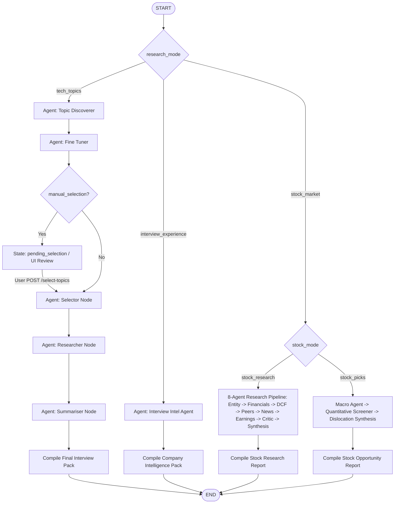

# Antigravity AI Research & Intelligence Platform
## Comprehensive Architecture & Steering Document

> **Target Audience**: AI Agents, Systems Architects, and Software Engineers onboarding or extending this codebase.  
> **Repository Root**: `/Users/yashburad/Workspace/AntigravityProjects/ResearchAgent`  
> **Primary Package**: `src/research_agent`  
> **Status**: Production-Ready / Fully Tested (49 Unit & Integration Tests Passing)

---

## 1. Executive Summary & Vision

The **Antigravity Research Agent** is an autonomous, multi-agent intelligence and decision support platform built with Python 3.13, LangGraph, FastAPI, and Pydantic. It provides a state-of-the-art developer platform for three complementary domains:

1. **Tech Topics Research Mode (`tech_topics`)**:
   - Continuously discovers emerging technical trends, systems architectures, and frameworks (e.g., Vector DB Hybrid Search, Distributed Consensus, Zero-Trust).
   - Evaluates and ranks candidates using multi-factor weighted scoring.
   - Performs deep web research and scrapes real documentation.
   - Synthesizes comprehensive architecture deep-dives and executive study packs.
   - Transforms complex research into interactive **3D Gamified Flashcards**.

2. **Company Interview Intelligence Mode (`interview_experience`)**:
   - Crawls recent candidate interview debriefs and experiences across LeetCode Discuss, Reddit (`r/cscareerquestions`, `r/ExperiencedDevs`), Glassdoor, and Blind for target organizations (e.g., Stripe, Google, Meta, Databricks).
   - Deconstructs hiring bars into round-by-round blueprints (DSA, Practical/API Bug Squashing, System Design, Behavioral/Leadership).
   - Synthesizes cultural operating principles and rubric scoring criteria.
   - Powers a live, multi-turn **AI Mock Interview Simulator** with real-time timers, contextual hint assistance, and Hiring Committee debrief scorecards.

3. **Stock Market Intelligence Platform (`stock_market`)**:
   - **Company Research Deep Dive (`stock_research`)**: 8-agent sequential pipeline executing entity resolution, 5-year financial statement health & margin trend analysis, deterministic 3-tier DCF & multiple scenario modeling, peer moat benchmarking, deduplicated news clustering, earnings surprise tracking, and an adversarial **Critic / Disconfirmation Agent** providing quantifiable thesis invalidation triggers.
   - **Opportunity Screener & Stock Picks (`stock_picks`)**: Macro regime analysis paired with quantitative screening and dislocation archetype classification (`Quality Growth + Temporary Selloff`, `Improving Fundamentals + Multiple Compression`, `Earnings Inflection + Unrecognized Catalyst`, `Capital Allocation & FCF Inflection`).

---

## 2. Core Architecture & Pipeline Topology

### 2.1 Pipeline State Machine (LangGraph)

The graph pipeline is managed in [`src/research_agent/graph.py`](file:///Users/yashburad/Workspace/AntigravityProjects/ResearchAgent/src/research_agent/graph.py) using LangGraph's `StateGraph`.



### 2.2 Shared Pipeline State (`ResearchAgentState`)

Defined in [`src/research_agent/state.py`](file:///Users/yashburad/Workspace/AntigravityProjects/ResearchAgent/src/research_agent/state.py):

| Field | Type | Description |
| :--- | :--- | :--- |
| `run_id` | `str` | Unique execution identifier (e.g. `run_2026_09_26_120000`). |
| `research_mode` | `str` | `"tech_topics"` or `"interview_experience"`. |
| `user_interests` | `str` | Comma-separated list of keywords for tech trend discovery. |
| `company_name` | `Optional[str]` | Target company (e.g. `"Stripe"`). |
| `target_role` | `Optional[str]` | Engineering role (e.g. `"Staff Backend Engineer"`). |
| `target_level` | `Optional[str]` | Seniority level (e.g. `"Staff / L6"`). |
| `raw_topics` | `List[TopicCandidate]` | Discovered raw trending topic candidates. |
| `refined_topics` | `List[RefinedTopic]` | Ranked and scored refined topic recommendations. |
| `selected_topics` | `List[str]` | Specific topics selected for deep-dive research. |
| `research_notes` | `Dict[str, ResearchNotes]` | Raw notes, URLs, architecture findings per topic. |
| `summaries` | `Dict[str, TopicSummary]` | Structured executive summaries & Q&As per topic. |
| `interview_intel` | `Optional[CompanyInterviewIntel]` | Full company round breakdown and debrief intel. |
| `manual_selection` | `bool` | Whether human review was requested before deep research. |
| `errors` | `List[str]` | Non-fatal error logs. |

---

## 3. Agent Ecosystem & Specialized Roles

All agents reside in [`src/research_agent/agents/`](file:///Users/yashburad/Workspace/AntigravityProjects/ResearchAgent/src/research_agent/agents/). Each agent encapsulates prompt loading, web interaction, and Pydantic structured generation.

### 3.1 `TopicAgent` (`topic_agent.py`)
- **Responsibility**: Discovers trending technical subjects using web queries combined with LLM analysis.
- **Resilience**: Features automatic fallback synthesis if web search or structured output encounters timeouts.
- **Output Model**: `List[TopicCandidate]`

### 3.2 `FineTunerAgent` (`fine_tuner_agent.py`)
- **Responsibility**: Evaluates candidate topics against user interests and computes a weighted composite score:
  $$\text{Final Score} = 0.30 \cdot \text{Match} + 0.25 \cdot \text{Interview Value} + 0.20 \cdot \text{Depth} + 0.15 \cdot \text{Freshness} + 0.10 \cdot \text{Source Quality}$$
- **Output Model**: `List[RefinedTopic]`

### 3.3 `ResearcherAgent` (`researcher_agent.py`)
- **Responsibility**: Conducts deep multi-query web searches, crawls articles/documentation, and extracts technical architecture details, trade-offs, and failure modes.
- **Output Model**: `ResearchNotes`

### 3.4 `SummariserAgent` (`summariser_agent.py`)
- **Responsibility**: Distills `ResearchNotes` into high-yield executive summaries, architectural diagrams/patterns, and top interview questions with ideal answers.
- **Output Model**: `TopicSummary`

### 3.5 `InterviewIntelAgent` (`interview_intel_agent.py`)
- **Responsibility**: Executes targeted crawling for real interview debriefs and constructs:
  1. Executive overview & candidate sentiment analysis.
  2. Round-by-round breakdown (DSA, Practical/Bug Squashing, System Design, Behavioral).
  3. Real interview questions & coding challenges.
  4. Company operating principles, values, and behavioral scoring rubrics.
- **Output Model**: `CompanyInterviewIntel`

### 3.6 `GamificationAgent` (`gamification_agent.py`)
- **Responsibility**: Converts research summaries into gamified 3D flashcard decks containing front questions, back comprehensive answers, subtle hints, categories, difficulty ratings, and core takeaways.
- **Output Model**: `FlashcardsGame`

### 3.7 `MockInterviewerAgent` (`mock_interviewer_agent.py`)
- **Responsibility**: Multi-turn dialogue agent acting as a Staff/Principal interviewer.
  - Generates realistic interview openings with problems tailored to the company round.
  - Evaluates candidate replies, asking probing follow-ups on edge cases and scalability.
  - Provides hints without revealing the full solution.
  - Generates a **Hiring Committee Debrief Scorecard** (`InterviewFeedback`) with numerical rubrics across 4 competencies (Technical Competence, Problem Solving, Communication, System Mindset) and recommendation verdicts (`Strong Hire`, `Hire`, `Lean Hire`, `Lean No Hire`, `Strong No Hire`).

---

## 4. Storage & File Layout Architecture

The storage subsystem in [`src/research_agent/storage/`](file:///Users/yashburad/Workspace/AntigravityProjects/ResearchAgent/src/research_agent/storage/) is anchored to the project root directory, guaranteeing consistency regardless of the current working directory.

### 4.1 Run Directory Layout
```
outputs/
└── run_2026_09_26_120000/
    ├── trending_topics.json
    ├── trending_topics.md
    ├── refined_topics.json
    ├── refined_topics.md
    ├── final_interview_pack.md          <-- (Tech Topics Mode)
    ├── company_interview_pack.md        <-- (Company Intel Mode)
    ├── interview_intel.json
    ├── research/
    │   ├── topic_a.json
    │   └── topic_a.md
    ├── summaries/
    │   ├── topic_a.json
    │   └── topic_a.md
    ├── games/
    │   └── topic_a_flashcards.json
    └── sessions/
        ├── session_123.json             <-- Live mock interview chat history
        └── session_123_feedback.json    <-- Hiring committee scorecard
```

---

## 5. LLM Abstraction & Provider Architecture

Located in [`src/research_agent/llm/`](file:///Users/yashburad/Workspace/AntigravityProjects/ResearchAgent/src/research_agent/llm/), the system uses a unified `LLMProvider` base interface:

```python
class LLMProvider(ABC):
    @abstractmethod
    def generate_text(self, prompt: str, system_instruction: Optional[str] = None) -> str:
        ...

    @abstractmethod
    def generate_structured(self, prompt: str, response_model: Type[T], system_instruction: Optional[str] = None) -> T:
        ...
```

### Supported Providers
1. **`GeminiProvider`** (`gemini.py`): Google GenAI SDK with native Pydantic schema enforcement.
2. **`OllamaProvider`** (`ollama.py`): Local inference (e.g. `qwen2.5:7b`, `llama3.1:8b`) with JSON schema enforcement.
3. **`OpenAIProvider`** (`openai.py`): OpenAI SDK with structured outputs.
4. **`MockLLMProvider`** (`mock.py`): Deterministic mock provider used in unit tests for zero API costs and lightning-fast execution.

### Dynamic Provider Selection
Configured in `.env` via `LLM_PROVIDER`:
```bash
LLM_PROVIDER=gemini # Options: gemini, ollama, openai, mock
DEFAULT_MODEL=gemini-3.5-flash-lite
GEMINI_API_KEY=your_key_here
```

---

## 6. Web Application & Frontend Architecture

The web interface is located in [`src/research_agent/web/`](file:///Users/yashburad/Workspace/AntigravityProjects/ResearchAgent/src/research_agent/web/):

- **Backend**: FastAPI with async non-blocking background workers (`threading.Thread`) and an in-memory status registry (`RUNS_DB`).
- **Frontend Stack**: Single-Page Application (SPA) built with Vanilla HTML5, Vanilla Modern CSS (glassmorphic dark theme, CSS grid/flex, custom properties), and Vanilla JavaScript.
- **View Modes**:
  1. **Interactive Setup View**: Dual-mode selection, interest tags, seniority selector, and manual filter toggle.
  2. **Topic Review Screen**: Responsive grid of scored topic cards with real-time selection counters.
  3. **Research & Interview Pack Viewer**: Sidebar navigation with tabbed markdown document viewer and instant `.md` download.
  4. **Practice Hub (Gamification)**: Interactive 3D flip flashcard deck with hint toggles, mastery counters, and keyboard shortcuts (`Space` = Flip, `ArrowRight` = Next, `H` = Hint).
  5. **Mock Interview Simulator**: Multi-turn chat terminal, live interview timer, round selection, hint assistant, and hiring committee scorecard modal.

---

## 7. Key Architectural Decisions & Rationale

| Decision | Rationale |
| :--- | :--- |
| **LangGraph over Linear Scripts** | Allows state persistence, conditional branching, non-blocking manual topic selection pauses, and resumption without losing discovered state. |
| **Strict Pydantic Validation** | Every agent returns typed Pydantic models. Guarantees strict contracts between pipeline stages and prevents malformed LLM outputs. |
| **Project Root Path Anchoring** | Resolving `outputs/` and `.env` relative to the repository root prevents file path fragmentation when `uvicorn` or scripts are executed from subdirectories. |
| **Dual-Mode Graph Topology** | Combines broad technological mastery with company-specific interview debrief intelligence into a unified interface. |
| **Mock LLM in Test Suite** | All 26 unit and integration tests run against `MockLLMProvider`, ensuring deterministic, sub-10s test suites with 0 API dependencies. |

---

## 8. Development & Extension Guide

### 8.1 Running the Server
From the project root:
```bash
# Start the FastAPI Web Server with auto-reload
uvicorn research_agent.web.app:app --host 127.0.0.1 --port 8000 --reload
```
Open **`http://127.0.0.1:8000/`** in your browser.

### 8.2 Running the Test Suite
```bash
pytest
```

### 8.3 How to Add a New Game Mode (e.g. Multiple-Choice Quiz)
1. **Model**: Define `QuizGame` and `QuizQuestion` in `src/research_agent/models/gamification.py`.
2. **Agent**: Add `generate_quiz(topic_summary)` to `GamificationAgent` (`src/research_agent/agents/gamification_agent.py`).
3. **Endpoint**: Add `GET /api/runs/{run_id}/games/{topic_slug}?game_type=quiz` in `src/research_agent/web/app.py`.
4. **UI**: Add Quiz component to `game-view-layout` in `src/research_agent/web/static/index.html` and `app.js`.

### 8.4 How to Add a New Agent Role
1. Create prompt template in `src/research_agent/prompts/<agent_name>.md`.
2. Define input/output Pydantic models in `src/research_agent/models/`.
3. Implement agent class in `src/research_agent/agents/<agent_name>.py`.
4. Add node and edge to `create_research_graph()` in `src/research_agent/graph.py`.
5. Add unit test in `tests/test_agents.py`.
